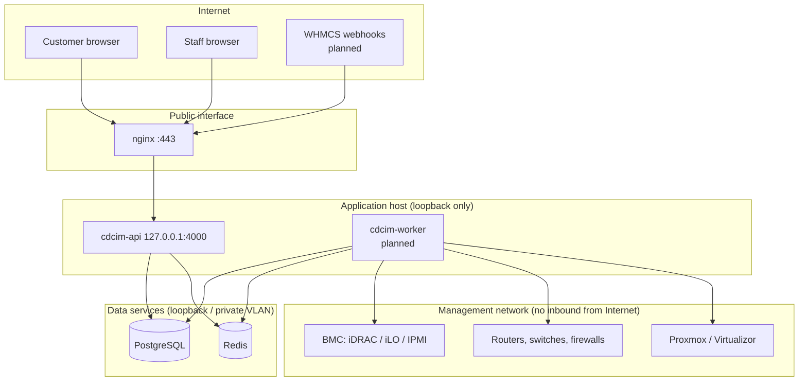

# Security model and boundaries

This document describes what Phase 1 enforces today. Items marked _(planned)_ are designed but not built yet.

## Trust boundaries

- Only nginx listens on a public interface. The API binds to `127.0.0.1` by default (`HOST`).
- Only the worker (Phase 4+) talks to the management network. The API never opens connections to devices on behalf of a request; it enqueues jobs. This keeps device credentials and management-network reachability out of the internet-facing process.
- PostgreSQL and Redis bind to loopback or a private VLAN, and Redis requires a password in production.

## Authentication

| Control | Implementation |
|---|---|
| Password storage | Argon2id, 19 MiB memory, t=2, p=1 (OWASP). Parameters are upgraded transparently at next login. |
| Password policy | Minimum 12 characters, plus a ban on common passwords, single repeated characters and passwords containing the user's email. |
| Enumeration resistance | Unknown email and wrong password return the same message, and a dummy hash keeps timing equal. |
| Lockout | After 5 consecutive failures, exponential lock (15 min doubling, max 24 h). The outcome is decided under a row lock (`SELECT … FOR UPDATE`), so parallel guesses cannot exceed the threshold and a correct password is refused while locked. Failed MFA codes and failed in-session re-authentication count toward the same limit. |
| Rate limit | Per-IP throttle on login and MFA routes (`LOGIN_RATE_LIMIT_PER_MINUTE`), plus a general per-IP budget. |
| MFA | RFC 6238 TOTP. The secret is encrypted at rest, codes cannot be replayed (last time step stored and updated conditionally), there are 10 single-use recovery codes, and each challenge allows 5 attempts with a 5-minute TTL. |
| Re-authentication | Changing the password or turning off MFA requires the current password. Failures are audited, throttled per IP and count toward lockout. Reaching the lock this way also ends all of the user's sessions, so a stolen session cookie can't be used to guess the password. |
| MFA policy | Organization setting `requireMfaForStaff`. Staff without MFA are restricted to enrollment routes. |
| Sessions | 256-bit random token in an HttpOnly, SameSite=Lax, Secure (prod) cookie. Only its SHA-256 hash is stored. Idle and absolute timeouts are set per organization. |
| Session revocation | On logout, password change (other sessions), MFA enable or reset, user disable, customer closure, or admin "sign out everywhere". |
| CSRF | Synchronizer token bound to the session. The readable `cdcim_csrf` cookie must be echoed in `X-CSRF-Token` on every unsafe method, and the server compares hashes in constant time. |

## Authorization

- Permissions are `resource.action` strings from a single catalog ([`permissions.ts`](../packages/shared/src/permissions.ts)).
- `*.read` never implies a write. Control operations (`hardware.control`, `network.config`, `provisioning.execute`) are separate permissions, so a read-only NOC role can never power-cycle a server or push a configuration.
- Permissions flagged **staff-only** cannot be placed in customer roles (rejected on save) and are dropped at request time for customer users even if a role were misconfigured. Unknown permission strings grant nothing.
- **No privilege escalation:** you can only assign roles, edit roles, or change anything about another user (roles, status, name) when you already hold every permission involved.
- The organization always keeps at least one active Super Administrator. User changes are serialized per organization with an advisory lock, so two admins disabling each other at once cannot leave none. Users cannot disable themselves or change their own roles.
- Every denial is audited with the missing permissions.

## Tenant isolation

- Every domain row carries `org_id`. Customer-owned rows carry `customer_id`.
- Services build their `WHERE` clause with `tenantFilter(principal, cols)`. For customer principals this adds `customer_id = principal.customerId`, so company-owned infrastructure (`customer_id IS NULL`) is invisible to customers by construction.
- An out-of-scope id returns **404**, the same as a missing one, so another tenant's resources cannot be discovered.
- Staff-only fields (internal notes, billing references) are stripped in the service view layer for customer principals.
- Administration routes (`users`, `roles`, `settings`, `audit`, `overview`) are marked `@StaffOnly()`.
- Database `CHECK` constraint: a user is a customer user if and only if `customer_id` is set.

## Secrets at rest

`SecretBox` (AES-256-GCM) encrypts MFA seeds today, and will encrypt SNMP communities and v3 keys, BMC passwords and integration tokens from Phase 3 on.

- Key ring in `CDCIM_ENCRYPTION_KEYS` (`id:base64key,...`). The first key encrypts and all keys decrypt, so a key can be rotated without downtime. `needsRotation()` finds values to re-encrypt.
- Additional authenticated data binds each ciphertext to its row and column, so a ciphertext copied elsewhere fails to decrypt.
- Secrets are **write-only** through the API _(planned for device credentials)_: responses show `configured: true`, never the value.
- Logs redact cookies, authorization headers, CSRF tokens and any field named like a password, secret, token, community or key. Audit metadata is sanitized with the same rule before hashing.

## Audit log

- Append-only table. `UPDATE`, `DELETE` and `TRUNCATE` are blocked by database triggers.
- Each row stores `hash = SHA-256(canonical row + previous hash)` per organization. `GET /api/v1/audit/verify` recomputes the chain and reports the first broken record. This detects tampering even by someone who can disable the trigger (tested).
- Appends are serialized by a per-organization advisory lock (tested under 15 concurrent writes).
- Changes and their audit rows commit in one transaction, so a change cannot succeed without its record.

## Transport and headers

- TLS terminates at nginx (Let's Encrypt or your own certificate). HSTS is enabled in production.
- Helmet applies CSP, `X-Content-Type-Options`, frame denial and other headers. `X-Powered-By` is removed.
- Request bodies are limited to 1 MB.

## Independent review

At the end of Phase 1, a separate reviewer audited this code. It found six defects, all fixed with regression tests in `apps/api/test/security-regressions.e2e.test.ts`: concurrent lockout bypass, a race between two super admins, unlimited MFA guessing across fresh challenges, a lower-privileged admin able to re-enable a super admin, unthrottled and unaudited in-session password checks, and a self-session revocation audited outside its transaction. The public readiness endpoint no longer returns raw dependency errors.

## Phase 2 review

A separate reviewer audited the physical-DCIM code and found nine defects, all fixed with regression tests in `apps/api/test/dcim-regressions.e2e.test.ts`:
- A customer change on a racked device, or a rack edit, could bypass a rack's dedication to a customer.
- Concurrent rack shrink and placement could both commit. The fit trigger now locks the rack row.
- A placement and a conflicting reservation could race. The rack row is now locked for both.
- A 0U device could reach a racked state without a rack.
- A model change on a racked 0U device left a sized device without a unit. A new DB check now prevents this.
- CSV import returned raw SQL in error messages and skipped range and date validation.
- Bulk and import audit records lacked the customer and before/after values.
- Customers could search by the staff-only management address.

## Phase 3: device credentials and discovery

- **Write-only secrets.** SNMP communities and v3 keys, RouterOS and NX-API passwords and FortiOS tokens are encrypted with the platform key ring (AES-256-GCM). No API returns them; the UI shows only "secret set" with a date. Audit records name the credential kind, host and user, never the secret.
- **Bound to a destination.** The ciphertext's additional authenticated data covers organization, device, kind, host and port. Copying a ciphertext to another device, or changing the stored host without re-entering the secret, makes it undecryptable. The host is fixed when the secret is saved, so a later edit to the device's management address (by someone with only `dcim.write`) cannot redirect a secret.
- **Only the worker decrypts.** `cdcim-worker` is a separate process. Jobs on the queue carry only a run id. Decrypted values live in one function scope, are redacted from any error text and are never logged (`authKey`, `privKey`, `community`, `password`, `token`, `secretEnc` are on the logger's redact list).
- **Read-only collection.** Adapters issue SNMP GET/GETBULK, HTTP GET, or NX-API `cli_show` with a fixed list of `show` commands. There is no code path that writes to a device. Applying a discovery changes only the DCIM database, never deletes documented ports, and is recorded in the audit log.
- **Permissions.** Configuring credentials needs `monitoring.configure` (a dangerous, staff-only permission). Starting a discovery and applying it needs `network.write`. Network infrastructure is staff-only; customers see only their own IP subnets and addresses, without infrastructure device names or staff subnets.
- **TLS.** Certificate verification is on by default for HTTPS adapters. Turning it off is a per-credential choice for self-signed management certificates. Plain HTTP is offered for labs and labelled as sending credentials in clear.
- **Reach of the worker.** Whoever holds `monitoring.configure` can point a credential at any host and port the worker can reach. Since Phase 9, `CDCIM_DEVICE_ALLOW` (CIDR list, e.g. the management networks) limits every connection made with stored device, BMC, console and hypervisor credentials; names are resolved and every address must be inside the list (the name is resolved again when connecting, so prefer IP addresses for BMCs and devices). Reachability pings are not credentialed and are not limited by it. The install check warns while it is unset. Still run the worker on a host whose network access is limited to the management network.
- **Timeouts.** Every SNMP request and HTTP call has a timeout (HTTP is a hard deadline for the whole request); each run has a 120-second ceiling; runs stuck for 15 minutes are marked failed so a device is never blocked.

## Phase 3 review

A separate reviewer audited the network, IPAM and discovery code. Confirmed defects, all fixed with regression tests in `apps/api/test/network-regressions.e2e.test.ts`:
- A credential with no host followed the device's management address at run time, so a `dcim.write` user could redirect secrets. The host is now saved with the secret and bound into its encryption context.
- LLDP neighbors were matched to our devices by the first label of their name, which could link another network's `core1.isp.net` to our `core1`. Matching now needs the exact name, or a bare name equal to our device's short name; address matches use the global table only.
- Applying a run whose neighbor collection failed deleted all existing observations. Deletion is now limited to protocols the run reported.
- A customer saw usage counts that included another customer's addresses in a nested prefix. Counts are per customer, and prefixes can no longer nest across customers.
- `PATCH /ipam/addresses/:id` cleared fields that were not sent.
- An invalid circuit status filter returned 500; a zero port speed returned 409.

Plausible items also addressed: concurrent applies are serialized per device; the worker no longer overwrites a run the API marked stale; discovery can't make a logical interface a LAG member; customer address views hide infrastructure device names and staff subnets; the 1 MB JSON limit applies everywhere except the two CSV import routes.

## Phase 3 completion review

A second review covered the RouterOS API client, scheduling, address import and DNS publishing. Confirmed defects, fixed with regression tests in `dns.e2e.test.ts` and `network-automation.e2e.test.ts`:
- Two addresses sharing a DNS name (round robin) synced at the same moment could drop one value from the PowerDNS record set. The worker now takes an advisory lock per zone, name and type, in sorted order, around each read-modify-write.
- Recording discovered addresses could silently bind an address IPAM already held for another customer (reserved, no device) to the discovered device. Existing IPAM rows are now never re-assigned from discovery; only an unbound interface on the same device is filled in, with a history entry.
- Disabling a child zone made names fall through to the parent zone. The most specific zone now decides, and a disabled one means "don't publish".
- Records left in a disabled zone after a rename showed as in sync. They are now reported, and any zone change re-queues affected addresses.

Also addressed: DNS calls no longer run while the address row is locked (a short claim, then the provider calls, then a compare-and-set that keeps a concurrent edit's pending state); the managed-record marker includes the organization id, so two organizations sharing a provider zone never touch each other's records; Cloudflare zone ids can't change while records exist; PowerDNS URLs must be http(s) without embedded credentials; the PTR field must be a valid host name; discovered addresses are compared in canonical form.

Known limitations: the DNS sweep handles pending addresses oldest first across all organizations, so an unreachable server slows publishing for everyone (each call is capped at 5 s); failed addresses are retried only when changed or when "Try again" / "Publish all again" is used.

## DNS credentials

PowerDNS API keys and Cloudflare tokens follow the device-credential rules: write-only, encrypted with AAD bound to the organization, server row, type and URL, decrypted only in the worker, redacted from error text. Configuring them needs `dns.manage` (dangerous, staff-only). Give Cloudflare tokens only Zone → DNS → Edit (and Zone → Read) on the zones DCIM manages.

## Phase 4: monitoring, alerts and notifications

- **Read-only polling.** Polling reuses the device credentials above and the same read-only adapters (SNMP GET/GETBULK, HTTP GET, RouterOS API `…/print`, NX-API `show`). Nothing in monitoring or alerting can shut a port, change a route or otherwise write to a device; alerts only record and notify.
- **Notification secrets.** SMTP passwords, webhook signing secrets, Slack webhook URLs (the URL is the secret) and Telegram bot tokens are encrypted with AAD bound to organization, channel id and kind, never returned (the API reports only non-secret settings), never written to audit metadata, and decrypted only by the worker. Editing a channel requires entering the secret again. Configuring channels needs `monitoring.configure`.
- **Outbound destinations.** Webhook and SMTP destinations that resolve to loopback, private, CGNAT, link-local (including cloud metadata 169.254.169.254) or multicast addresses are refused unless the worker runs with `CDCIM_NOTIFY_ALLOW_PRIVATE=true` (for internal receivers). Slack URLs must be `https://hooks.slack.com/…`. Redirects are not followed and the receiver's response body is not stored (only the HTTP status). The check resolves the name before connecting, so DNS rebinding between check and connect is not prevented; run the worker with egress limited to what it needs.
- **Signed webhooks.** Each request carries `X-CDCIM-Timestamp` and `X-CDCIM-Signature: sha256=<hex HMAC-SHA256(secret, timestamp + "." + body)>`. Receivers should reject old timestamps.
- **Live stream tenancy.** Customers receive only rates for ports on their devices or cabled directly to them, without device error text, and no alert events. Organization totals, polling health, alerts, rules, channels and settings are staff-only. Streams end after 15 minutes so revoked sessions and changed permissions take effect on reconnect; a user can hold at most 10 streams.
- **Independent review.** A reviewer audited Phase 4 before release. Fixed: a database outage during a failed poll could crash the worker; link state was shown from stale readings; alerts on devices or ports no longer polled could never resolve; notification destinations could reach internal hosts and echo their responses; rollups didn't catch up after worker downtime; a slow notification batch could be re-claimed by a second worker; alert streaks continued across long gaps; a rule edited during evaluation could still raise an alert under the old definition; streams had no per-user limit or lifetime. Regression tests are in `monitoring.e2e.test.ts`.

## Phase 5: power collection

- **BMC and PDU credentials** follow the device-credential rules (write-only, encrypted with AAD bound to org, device, kind, host and port, decrypted only by the worker, redacted from errors). Use read-only BMC accounts (iDRAC "Read Only", iLO "Login", IPMI USER privilege) and read-only SNMP.
- **IPMI** runs the system `ipmitool` with `execFile` (no shell), a fixed set of read commands (`mc info`, `dcmi power reading`), host and user name checked against a strict pattern, and the password only in the `IPMI_PASSWORD` environment variable (`-E`), never on the command line. IPMI v2.0 passwords are limited to 20 characters.
- **Read-only.** Redfish adapters send only GET requests and follow links only inside `/redfish/v1` on the stored host (no `..`, no percent-encoding). One exception, for Dell iDRAC firmware whose Redfish has no memory list: the hardware collector sends WS-Man Enumerate/Pull for the `DCIM_MemoryView` class only (a read; the class URI is fixed in code). The server-health poller (every 5 minutes per server in service) uses the same read-only BMC credential: GETs of the system and its Thermal resource and, on Dell iDRACs, WS-Man Enumerate of `DCIM_SystemView` / `DCIM_NumericSensor` (fixed class URIs). It never powers, resets or changes anything; failures are stored with secrets redacted and shown as a warning only. SNMP is walk/get only. Nothing in Phase 5 switches an outlet or sends a power action; power control is a separate, later permission (`hardware.control`).
- **Tenancy.** Customers see the equipment assigned to them: current power, labelled estimates and energy. They do not see cost, rack or datacenter, collection status or errors, PDUs, tariffs or other customers' devices, and a device's history is limited to the hours it was theirs.
- **Independent review.** Fixed before release: customers could see rack names and collection error text; a device's new customer could read the previous customer's history; a PDU outage could be bridged using another source's polling interval; recomputing recent hours applied today's customer, rack and estimate to closed hours; the rollup could stall after an empty catch-up window and loaded every organization at once; a server with only one of two supplies mapped got a half-size PDU reading that outranked its BMC; a device feeding outlets but not categorised as a PDU was counted as load; daisy-chained APC units overwrote each other's outlets; Redfish links allowed percent-encoding. Regression tests are in `power.e2e.test.ts` and `energy.test.ts`.

## Phase 6: provisioning and control

- **Separate control credentials.** Power and boot control use a BMC account stored apart from the read-only monitoring credential (`control_credentials`), write-only and encrypted with AAD bound to org, device, kind, host and port; only the worker decrypts it, and errors are scrubbed of it. Hypervisor sync uses a read-only token; VM actions need a second Proxmox token or an explicit Virtualizor opt-in.
- **BMC entered once.** `PUT /dcim/devices/:id/bmc` (staff, `monitoring.configure`) takes the BMC address and login once and stores it, through the same services and audit records as before, as separate encrypted credentials per use: the read-only monitoring credential always; power readings (`power.configure`); power control only when ticked (`provisioning.execute`); serial / graphical console only when ticked (`hardware.console` + `provisioning.execute`). A use the caller lacks permission for is reported as not set, never silently granted. Monitoring may use a separate read-only BMC account (recommended); when it shares the control login, the monitoring code still sends only reads. Passwords are never returned.
- **Permissions.** Power and VM actions need `hardware.control` (customers only on their own equipment) and the target's name typed as confirmation. Installs, images, credentials, cancellation and recovery decisions need `provisioning.execute` and are staff-only. Every request, decision and completion is audited.
- **No unrequested actions.** A graceful shutdown or restart the OS ignores fails the job; it is never escalated to a hard power-off. IPMI's "soft" (an ACPI shutdown) is not offered as a restart. Nothing changes router configuration or routes.
- **Verification before success.** Jobs complete only after the effect is observed (BMC power state; a new boot for resets; installer callback or the new system on its address after the port was seen closed; one-time boot consumed; media ejected). Where the equipment cannot show it, the job is labelled "not verified".
- **Secrets in installs.** The root password is turned into a SHA-512 crypt hash when the job is created; the plaintext is not stored. The hash and the boot token are encrypted in the job and deleted when it ends. The boot token is stored only as a SHA-256 hash.
- **Boot endpoints** (`/api/v1/boot/*`) have no session. They answer only source addresses in `CDCIM_BOOT_ALLOW` (private ranges by default; loopback deliberately excluded because a local reverse proxy would make every request look local; behind nginx set `TRUST_PROXY_HOPS=1`), only for an install that has reached its boot step, and hand the installer out once. A second request for the script or the MAC-keyed config before the installer reports is treated as a conflict and stops the job (fail closed). Use an isolated provisioning network: anyone on an allowed network who knows the MAC can race the server for the script.
- **Image downloads** refuse loopback, link-local (including cloud metadata) and multicast addresses unless `CDCIM_IMAGE_ALLOW_LOCAL=true`; every redirect is checked; private mirrors are allowed. DNS rebinding between the check and the connection is not prevented (image URLs are staff-entered).
- **Independent review.** Fixed before release: IPMI "ACPI restart" left servers off; restarts and VM reboots were reported verified because the power state stayed "on"; a TCP check could be satisfied by the old OS; Virtualizor "shut down" was a hard power-off and customers could lift an administrative suspension; a PXE server could reinstall on every boot; the boot allow-list included loopback and MAC lookup could be repeated; an image edited during verification could be marked verified; a verification could stick in "verifying"; a VPS's status could come from another VPS; image downloads followed redirects to internal addresses; cleanup could miss half-done steps; a cancelled job interrupted by a crash went to recovery; inventory updates could repeat after a crash; IPAM checks compared text, not addresses. Regression tests are in `provisioning.e2e.test.ts`.

## Phase 7: colocation and the customer portal

- **Tenant isolation** is enforced in every query (`org_id`, and `customer_id` for customer users) and tested for every new resource: lists, details and status changes of another customer's allocation, cross-connect, shipment, visit, service or ticket return 404. A customer cannot file anything for another customer or reference another customer's device, port or service; a database trigger keeps all references inside the organization and links services to the same customer.
- **Staff-only data** is removed before it reaches customers: staff notes, internal ticket notes, non-billable time, cable ids, assignees and staff email addresses (shown as "Datacenter team").
- **Permissions:** customer viewers (no `tickets.write`) can read the portal but not file requests; staff need `services.write` to manage allocations, services and request status. Status changes on services are records only: nothing is switched off when a service is suspended.
- **Personal data:** visits keep visitor names and only the last 2–4 characters of an ID number; the audit log records the number of visitors, not names.
- **Independent review.** Fixed before release: customers saw non-billable minutes in the ticket total; devices could be counted in two allocations (and zero-U equipment in all of them), inflating power; "over contract" counted estimates; staff email addresses reached customers; a future end date freed space early; updating an allocation cleared omitted fields and accepted an ended service; visits could be checked in outside their window and a customer's cancel note replaced the team's note; customers could set a cross-connect id when withdrawing; ticket search did not escape wildcards. Half and quarter splits of racks whose height doesn't divide evenly give the extra units to the top part (documented in the UI's range preview).

## Phase 8: API keys, webhooks, workflows and billing

- **API keys** are random 256-bit secrets (`ndc_<prefix>_<secret>`), stored only as SHA-256 hashes and compared in constant time. A key's scopes must be permissions its creator holds, and every request is limited again to the owner's *current* permissions; a disabled owner, or one who must still enrol in MFA, makes the key useless. Keys can't manage keys, sign in, change users, roles or settings, approve workflow steps, or receive webhook and billing secrets (*session only*). Key requests skip CSRF because browsers can't send the `Authorization` header cross-origin (CORS doesn't allow it). Every request made with a key is audited under the key's name.
- **Outbound webhooks** are signed (HMAC-SHA256 over `timestamp.body`); secrets are encrypted at rest (AAD bound to the subscription) and shown once. Receivers on private, loopback or link-local addresses are refused unless `CDCIM_WEBHOOK_ALLOW_PRIVATE=true`, and the address is checked again when connecting, so DNS rebinding can't reach internal hosts. The same connect-time check now protects notification channels.
- **Workflows** can only create or change tickets and send notifications: there is no action that powers equipment, changes network configuration or touches routes. Approval steps need a second person (the last editor can't approve), editing a workflow stops runs that were waiting or approved, and a run that started on one version never continues on another. Events caused by a workflow never trigger workflows.
- **WHMCS intake** is public but signed with a per-integration secret (encrypted at rest, shown once), with a 5-minute timestamp window and constant-time comparison over the raw body. Each event id is applied once (unique index plus a per-client/service lock); repeats return the first outcome. Billing events change records only; suspension or termination never switches anything off. Closing a client is held for review instead of locking portal users out automatically.
- **Reports** are scoped like the rest of the API (customers: their own account; capacity: staff), CSV cells that start with `= + - @` are neutralized, and scheduled reports reuse an email channel's SMTP settings without exposing the password.
- **Incidents and notices** show customers only public items that affect them; internal updates, staff identities, maintenance window names and notes are withheld.
- **Independent review.** Fixed before release: a schedule whose channel stopped being email could block all scheduled reports; an approved workflow step could run after the workflow was edited (four-eyes bypass) and runs created before an edit could fail partway; WHMCS event ids grouped separate changes within a minute; two events could create the same service twice; usage counted PDUs' energy as well as the servers they feed; customer-internal links doubled the 95th percentile; keys could manage users, roles and settings; the provisioning event was written outside the job's transaction; the module's connection test stored an empty reconciliation; the module's yes/no options couldn't be switched off; webhook destinations were open to DNS rebinding; customers saw internal maintenance window names; a run the worker kept crashing on was retried forever.

## IP reachability

The worker pings addresses only in prefixes where an administrator turned the check on, with the system `ping` (one echo request, 1-second timeout, at most 64 at a time, every 5 minutes). It sends nothing else and changes nothing. Results are stored per address; when ping itself cannot run, the error is shown on the prefix instead of marking addresses down.

## Device reachability

The worker runs two pings per device: the management address (or the host of the device's first stored credential), and the server address (or the host name when it is a full DNS name). It checks devices that are racked, provisioning, active or in maintenance, once a minute, with one echo request and one retry. The address must be an IP literal or a DNS name (a URL or host:port is reduced to its host); anything else is refused before it reaches `ping`, so a stored value can never become a `ping` option. Results show only up / down and the address pinged (customers see it for their own equipment only, since 15 October 2026); a check error or a result older than five minutes is shown as "not checked", never as down. Nothing else is sent to the device.

## Remote console

A console gives full control of a server, so it has its own permission, `hardware.console`, separate from monitoring (read-only credentials) and power control. Super and operations administrators have it; customer roles do not by default, and a customer granted it reaches only their own servers. Console secrets (VNC password, IPMI Serial-over-LAN login) are stored encrypted, bound to their device and kind, set only by staff with `provisioning.execute`, and never returned.

Opening a console issues a one-time ticket (random, stored as a SHA-256 hash, valid 60 seconds). The browser presents it on the WebSocket `/api/v1/console/ws`; cross-site origins are refused. The API never connects to a BMC: it hands the connection, with a single-use relay token, to the worker's relay on 127.0.0.1, which alone talks to the BMC. For VNC the relay authenticates to the BMC itself and offers the browser a password-less RFB session, so the password never leaves the server; for Serial-over-LAN, ipmitool gets the password in its environment, never on the command line. One live session per server and console; sessions end after 15 minutes without input or 8 hours, when ended by staff, or when the worker restarts. Every start, end, credential change and BMC web-console opening is in the audit log, and each session (who, when, bytes, how it ended) in the console session log.

The worker-to-BMC VNC hop is plain RFB (VNC SSL encryption on the BMC must be off); keep BMCs on a management network. The BMC web console link opens the BMC's own interface in the user's browser, which needs network access to the BMC and has its own login.

## Phase 9: production hardening

- **Shared rate limits.** Request and sign-in limits are counted in Redis, so several API processes share one budget per client. If Redis is unreachable, each process falls back to counting in memory: limits stay on rather than switching off.
- **Installed code is read-only to the service.** Releases are built as the service account, then owned by root; the `cdcim` account can run but not change the code, the configuration (`api.env`, root:cdcim 0640), the backup key or the audit anchors. Application code never runs as root: the root-owned `crapplet-dcim` command only moves files, runs PostgreSQL tools and openssl, and calls the application as `cdcim`.
- **systemd sandbox.** API and worker run with `NoNewPrivileges`, `ProtectSystem=strict`, `ProtectHome`, `PrivateTmp`, `PrivateDevices`, kernel and control-group protection, no capabilities, `RestrictNamespaces`, `RestrictAddressFamilies` (unix, inet, inet6, netlink) and memory limits.
- **Encrypted backups.** AES-256-CTR (key from PBKDF2 over a 256-bit backup key), then HMAC-SHA256 over the ciphertext; the HMAC is checked before anything is decrypted, and a backup made with another key, damaged or altered, is refused. The MAC key is derived inside a process, never placed on a command line. Backups, the key and the anchors are root-only. A restore loads into a separate database and switches only after the load succeeded.
- **Key rotation.** `crapplet-dcim secrets check|rotate` covers every encrypted column (a test fails if a new one is added without it), re-encrypts with the newest key without ever printing a secret, and reports rows that no longer decrypt.
- **Audit anchors.** Daily, the newest audit event id and hash of each organization are appended, as root, to a file the service account cannot change; the install check verifies the chain and that every anchored event still exists unchanged. This closes the Phase 1 gap (removal of the newest records). Copy the anchor file off the server to protect against a root compromise.
- **Install check.** `crapplet-dcim doctor` reports insecure settings (plain HTTP, listening on all addresses, API explorer on, Redis or PostgreSQL reachable from the network, no device allow-list), unreadable secrets, a broken audit chain, staff without MFA, missing backups, stopped services, wrong file permissions and firewall rules that block the web port.
- **Self-review, not independent.** Phase 9 was reviewed by the same author who wrote it (findings fixed: running application code as root for backups and anchors, the HMAC key visible in the process list, a failed restore leaving no database, pruning that aborted the backup command). An independent review is still recommended before production use.

## Flow collector (bandwidth per IP)

* The worker listens on UDP 2055 (`CDCIM_FLOW_PORT`, `0` turns it off) for NetFlow v5/v9 and IPFIX. The listener is passive: nothing is ever sent to the routers.
* Only packets whose source address is a registered, enabled exporter are read. Everything else is dropped; the last few unknown sources are shown to staff so a router's real source address can be registered.
* UDP source addresses can be forged. Someone who can send packets that appear to come from a registered router could add false traffic figures (not read or change anything else). Restrict the port to your routers at the firewall where possible (`firewall-cmd --permanent --add-rich-rule='rule family=ipv4 source address=ROUTER/32 port port=2055 protocol=udp accept'`), or keep flow export on a management network.
* The decoder checks every length and rejects a malformed packet as a whole (fuzz-tested with random input). Templates are capped per collector and expire after 6 hours; per-IP counters in memory are capped at 500,000 entries per 10-second flush.
* Only addresses inside your IPAM prefixes get traffic totals. Flows where neither end is yours are counted (as "not your addresses") and dropped.
* Remote addresses (the other end of a flow with one of your addresses) are stored as hourly totals: the busiest 20 per address and hour (approximate counting, at most 100 per address and 300,000 in memory per hour), kept for 14 days and then deleted by the daily retention job. The live snapshot keeps the top 5 for the 300 busiest addresses for 30 s. A customer sees the remote addresses of their own addresses only. These are personal-data adjacent (they reveal who your customers talk to), so treat database backups accordingly.
* ASN and location of remote addresses are looked up on this server from offline databases (DB-IP "IP to City Lite" and "IP to ASN Lite", CC BY 4.0, attributed on the page; MaxMind GeoLite2 files placed in `CDCIM_GEOIP_DIR` also work). No address is sent to any outside service. The worker downloads the DB-IP files from `https://download.db-ip.com` when missing or older than 35 days (checked every 6 hours; `CDCIM_GEOIP_DOWNLOAD=false` turns this off), caps the download at 600 MB, and only replaces the current file after the new one opens and answers a lookup. Private, CGNAT, loopback, link-local, multicast and documentation ranges are never looked up. Locations are approximate: the country is usually right, the city often is not.
* Customers see only addresses assigned to them, directly or through a prefix assigned to them, and never the exporter configuration.
* Real time per IP (optional, per router): while someone has the live view open (a heartbeat that lapses after 20 s), the worker streams MikroTik Torch on the configured interface over the device's stored RouterOS API credential. Torch is a read-only monitor; the API client can only send `/login`, `…/print`, `/tool/torch` and `/cancel`, and the interface name cannot contain API separators. Torch costs router CPU while it runs, so it stops as soon as nobody watches. The rates are kept in Redis for 5 seconds and never stored.

## Hypervisor live readings and VM remote-access checks

* While a staff member has a Virtualizor or Proxmox page open (a heartbeat that lapses after 20 s), the worker reads node CPU and memory every 5 s with the integration's read-only credential, and checks each running VM's remote access: a TCP handshake to its first IPv4 address on 3389 (Windows, by OS or name) or 22 (others). Nothing is sent over the connection and no login is attempted; at most 128 checks run at once, 1.5 s each. Results are kept in Redis for 30 s and not stored. These checks go to customer VM addresses (not management networks) and carry no credentials, so `CDCIM_DEVICE_ALLOW` does not apply to them.
* "Not reachable" means NexoraDC could not open the port: the VM may block NexoraDC's address, use another port, or be down. It says nothing about reachability from elsewhere.
* A VM's manage page reads its CPU, memory, disk and bandwidth every 5 s while it is open (read-only, Redis only). Staff, or the customer the VM is assigned to.
* VM console (Virtualizor): opening it needs `hardware.console`, VM actions enabled for the hypervisor, and the VM to be the customer's own for customer users. The browser gets a one-time ticket only; when it connects, the worker asks Virtualizor for the VM's VNC address and password (VNC Info) with the stored credential and connects. The password never reaches the API, the browser or the logs. One console per VM at a time; every session is logged with who opened it and how it ended.
* Not offered from NexoraDC: changing a VM's root password or hostname without reinstalling. Virtualizor's admin API documents no single-purpose call for these, and its edit call takes the full VM settings, so a partial request could change the plan.

## VM reinstall (Virtualizor)

* Reinstall erases the VM's disk. It is staff only (`hardware.control`), needs the integration's VM-actions opt-in, the template must be one the panel reported at the last sync, and the VM's name must be typed.
* The new root password is required by Virtualizor. NexoraDC encrypts it in the job's secret (same envelope as other job secrets), sends it to Virtualizor once in the POST body (never in the URL), and deletes it from the job right after Virtualizor accepts the request; the job's end clears it again. It is not in the job's parameters, steps, audit entry or logs; the idempotency check compares only a SHA-256 of it.
* The rebuild step is never repeated automatically; an interrupted one goes to recovery for a person.

## ISO uploads and the PXE service

- **Uploads** are staff-only (`provisioning.execute`), in chunks of at most 16 MiB written at the server's own offset; free disk space for the ISO and an extracted copy is checked first. The file is read with `bsdtar` (list, extract) by the worker; nothing in it is executed. Extraction drops ISO ownership and permissions. An optional vendor SHA-256 is compared before the image can be used.
- **Install files** are served under `/api/v1/boot/files/<token>/…` only for the job holding that token, only while it is active, only from allowed networks (`CDCIM_BOOT_ALLOW` plus the PXE settings' networks), with path resolution confined to the image's own directory (no `..`, no links out). Plain HTTP is used for the boot endpoints (nginx serves `/api/v1/boot/` on port 80 too) because iPXE and installers cannot check certificates; the token and the job's lifetime limit what a passive observer could fetch. Install configurations contain the root password only as a SHA-512 crypt hash.
- **dnsmasq runs as root (then drops to its own user); the NexoraDC worker does not write its configuration.** The worker writes a small JSON desired state; a root helper accepts it only as a regular file (no symlink) owned by the service user, validates every field against a strict schema (IPs, CIDRs, interface name, MACs, `http://host[:port]`) and renders the configuration itself. Rejections report field names only. A compromised worker can therefore change which known MACs are answered and the boot URL, not add dnsmasq directives (`dhcp-script`, `conf-dir`, …). The helper and dnsmasq are root-owned release files.
- **dnsmasq answers only MACs with an active network install** (`dhcp-ignore=tag:!nexora`): other devices on the network get no address or boot offer, in every mode. Its DNS is off (`port=0`). Removing a MAC reloads it (SIGHUP) so it is forgotten at once; even a stale entry only reaches NexoraDC's "no install for this server" answer.
- **Nothing on routers is changed.** Relay or next-server settings on a router are shown as commands for the operator.
- **Interactive installs** are completed by an operator ("Mark finished", audited) and recorded as not verified by NexoraDC.

## Dependency advisories

`npm audit --omit=dev` reports only the `js-yaml` advisory below (Swagger UI, disabled in production). The remaining advisories are in development and test tooling (`vitest` 2, `esbuild`, `tinypool`, `drizzle-kit`'s bundled `esbuild`) that never runs in production installs; they are scheduled for the next tooling upgrade.

## Known limitations (Phase 1)

- ~~The audit hash chain does not detect removal of the newest records~~: closed in Phase 9 by daily anchors outside the database (see above).

- ~~Rate limiting is per API process~~: shared through Redis since Phase 9.
- `@nestjs/swagger` 11 pulls in a `js-yaml` version with a moderate CPU-exhaustion advisory. It is reachable only through the Swagger UI, which is **disabled in production by default** (`ENABLE_SWAGGER`). The fix requires `@nestjs/swagger` 12 (breaking change) and is scheduled for the next dependency update.
- ~~Backup encryption, credential rotation tooling and management-network isolation checks~~: done in Phase 9.
